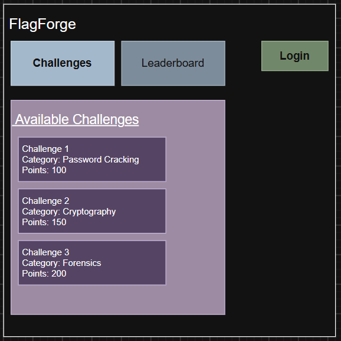
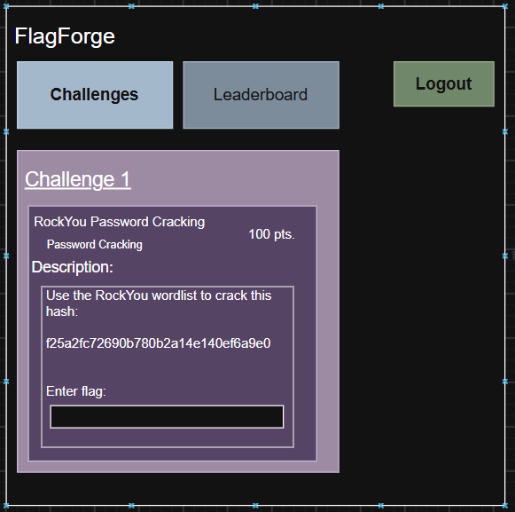
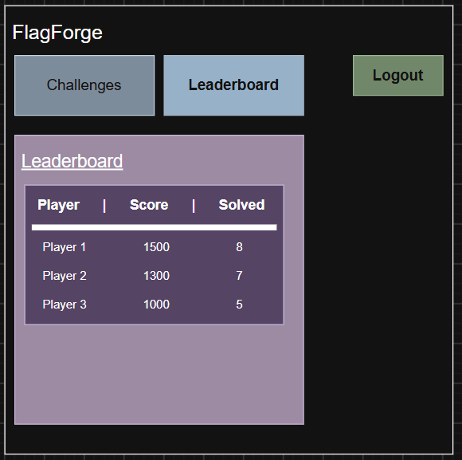
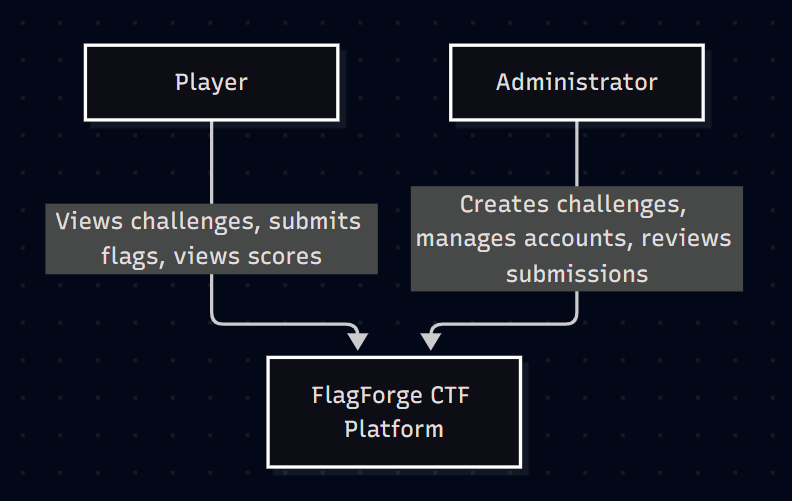
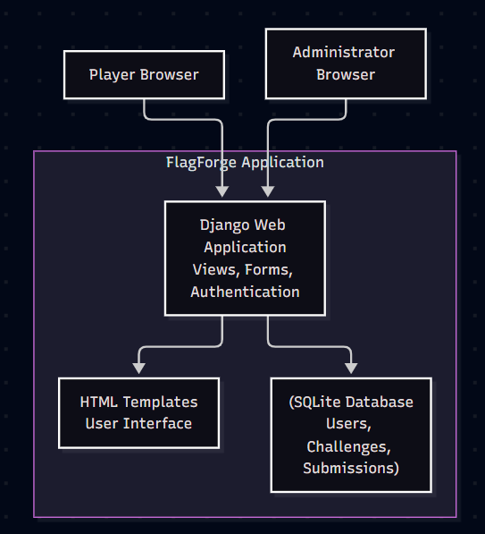
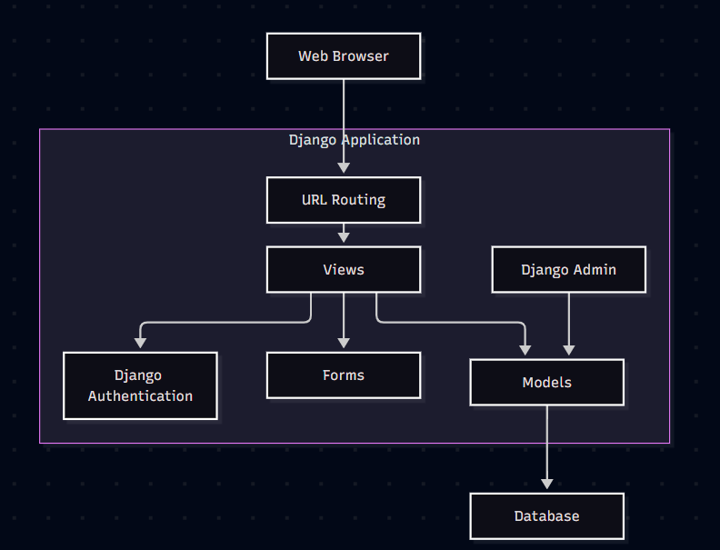

# FlagForge - Project Documentation

## 1. User Stories

### Player User Stories

1. As a player, I want to view available challenges to find cybersecurity problems to solve.

#### Acceptable Criteria
- Players can view all published challenges

2. As a player, I want to view a challenge's description to understand what I need to do.

#### Acceptable Criteria
- The challenge page displays its description, category, and point value

3. As a player, I want to view the leaderboard to compare my score with others.

#### Acceptable Criteria
- The leaderboard displays player usernames, total points earned, and number of challenges solved.

### Administrator User Stories

1. As an administrator, I want to create and manage challenges so I can provide exercises for players.

#### Acceptable Criteria
- Administrators can create challenges through Django's admin interface

2. As an administrator, I want to create player accounts so I can control who has access to the platform.

#### Acceptable Criteria
- Administrators can create user accounts through the Django admin interface

3. As an administrator, I want to review player submissions so I can monitor challenge activity.

#### Acceptable Criteria
- Administrators can view submitted flags as records

## 2. Mis-User Stories

### Mis-User Story 1: Unauthorized Challenge Access

As a malicious unauthenticated user, I want to access challenge details without logging in so I can obtain information without having an account.

#### Mitigation Criteria:
- Unauthenticated users are redirected to the login page
- Challenge pages require authentication

### Mis-User Story 2: Repeated Flag Submissions

As a malicious player, I want to repeatedly submit flags to guess the correct answer so I can solve challenges without completing them.

#### Mitigation Criteria:
- Correct flags are stored as password hashes instead of plaintext
- Submission rate limiting should be implemented to restrict repeated guessing attempts

### Mis-User Story 3: Manipulating Scores

As a malicious player, I want to submit the same correct flag multiple times to get more points without solving other challenges.

#### Mitigation Criteria:
- A player can only receive credit for a challenge once

## 3. UI Mockup

### Challenge Tab

### Challenge Detail Page

### Leaderboard Page

## 4. Architecture Diagrams

### System Context Diagram

### Container Diagram

### Component Diagram

## 5. Prototype

The initial FlagForge prototype is built using Python and Django

Implementation includes:
- Player login using Django Authentication
- Challenge listing and detail pages
- Flag submission and validation
- Correct/incorrect submission feedback
- Leaderboard scoring
- Administrator challenge management using Django Admin
- Player account management using Django Admin
- SQLite database storage

The prototype focuses on core functionality needed to use a basic CTF platform. Addition features and security improvements can be introduced as development continues.